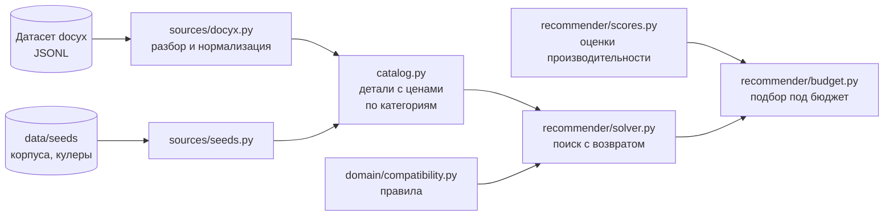

# pcbuilder

Подбор комплектующих для ПК: по бюджету и задаче собирает совместимую конфигурацию из реальных товаров с ценами.

```
$ python scripts/budget_demo.py 1200

Профиль: игры. Требования: память ≥ 32 ГБ, планок ≥ 2; DDR5 ≥ 5600 МГц; NVMe SSD ≥ 1000 ГБ; БП не хуже 80 Plus Bronze

=== Бюджет 1200 USD
  CPU         Intel Core i5-14400F                     125.99
  Видеокарта  Asus PRIME (Radeon RX 9070 XT)           612.98
  Плата       ASRock H610M-HDV/M.2+ D5                  89.57
  Память      TEAMGROUP T-Create Expert 32 GB           72.99
  Диск        PNY CS1030                                49.99
  БП          Apevia Prestige                           51.99
  Корпус      Montech AIR 903 MAX                       74.99
  Кулер       Thermalright Assassin X 120 Refined SE    17.89
  Итого                                               1096.39
```

## Возможности

- **Проверка совместимости** — 14 правил: сокет, тип и количество памяти, форм-факторы, длина видеокарты и высота кулера под корпус, мощность и разъёмы блока питания, слоты накопителей. Работает и для неполной сборки — поэтому подходит как для пошагового конструктора, так и для автоматического поиска.
- **Загрузка реальных данных** — ~24 000 деталей из открытого снимка PCPartPicker с нормализацией: вывод сокета по микроархитектуре, типа памяти платы по названию и сокету, TDP видеокарты по чипсету.
- **Достройка сборки** — задаёшь процессор и видеокарту, солвер подбирает остальное подешевле с учётом совместимости и требований к качеству.
- **Подбор под бюджет** — задаёшь сумму и профиль («игры» или «работа»), получаешь сборку с лучшей оценкой, которая укладывается в бюджет.

## Как это работает



1. **Источники** превращают чужие данные в доменные модели (`CPU`, `Motherboard`, `RamKit`, …) и цены (`Offer`). Запись, которую нельзя разобрать надёжно, отклоняется с причиной: лучше не загрузить деталь, чем загрузить с неправильными данными.
2. **Каталог** собирает детали из всех источников и оставляет только те, у которых есть цена, отсортированные от дешёвых к дорогим.
3. **Солвер** заполняет категории по очереди, перебирая кандидатов от дешёвых к дорогим. После каждой детали проверяется частичная сборка, а заглядывание вперёд отсекает выбор, после которого какую-то из следующих категорий уже не заполнить.
4. **Подбор под бюджет** перебирает пары «процессор + видеокарта» от лучшей оценки к худшей. Пары, которые не укладываются в бюджет даже по нижней границе цены, отбрасываются без поиска. Для игр оценка — узкое место: `min(видеокарта, процессор × 1.2)`, поэтому солвер не переплачивает за процессор, который видеокарта всё равно не нагрузит.

## Быстрый старт

Нужен **Python 3.12+**.

```bash
git clone https://github.com/kchaumeow/pc-builder.git
cd pc-builder

python3.12 -m venv .venv
source .venv/bin/activate
pip install -e ".[dev]"

pytest
```

Для скриптов нужен датасет. Склонируй его **рядом** с проектом:

```bash
git clone --depth 1 https://github.com/docyx/pc-part-dataset.git ../pc-part-dataset
```

По умолчанию скрипты ищут его в `~/projects/pc-part-dataset`. Другой путь задаётся переменной окружения:

```bash
export DOCYX_PATH=../pc-part-dataset
```

### Скрипты

| Команда | Что делает |
|---|---|
| `python scripts/budget_demo.py` | подбор под несколько бюджетов, профиль «игры» |
| `python scripts/budget_demo.py 1500` | один бюджет |
| `python scripts/budget_demo.py 2000 --work` | профиль «работа» — упор на многоядерность |
| `python scripts/solve_demo.py` | достройка сборки вокруг заданных процессора и видеокарты |
| `python scripts/demo_build.py` | ручная сборка из реальных деталей и её проверка |
| `python scripts/explore_docyx.py [категория …]` | разведка датасета: значения полей, статистика загрузчиков, неожиданные отказы |

### Из кода

```python
from decimal import Decimal
from pathlib import Path

from pcbuilder.catalog import load_catalog
from pcbuilder.domain.compatibility import check
from pcbuilder.recommender.budget import best_build
from pcbuilder.recommender.scores import GAMING
from pcbuilder.recommender.solver import Requirements

catalog = load_catalog(Path("../pc-part-dataset"))

result = best_build(catalog, Decimal(1200), GAMING, Requirements(min_ram_gb=32))
build = result.solution.build
print(build.cpu.name, build.gpu.chipset, result.solution.total)

check(build, complete=True)  # [] — замечаний нет
```

## Структура

```
pc-builder/
├── src/pcbuilder/
│   ├── domain/
│   │   ├── models.py          # модели деталей, сборки и предложений
│   │   └── compatibility.py   # правила совместимости и полноты, check()
│   ├── sources/
│   │   ├── docyx.py           # загрузчик датасета docyx: разбор, нормализация, цены
│   │   └── seeds.py           # загрузчик справочников из data/seeds
│   ├── recommender/
│   │   ├── solver.py          # достройка сборки, требования к качеству
│   │   ├── scores.py          # оценки производительности, профили
│   │   └── budget.py          # подбор под бюджет
│   └── catalog.py             # детали с ценами по категориям
├── data/seeds/                # справочники, заполненные вручную
├── scripts/                   # исследовательские и демо-скрипты
└── tests/                     # тесты правил, загрузчиков, справочников и солвера
```

`domain/` не зависит ни от чего внешнего: это знания о железе, которые верны независимо от того, откуда пришли данные. Солвер работает только с каталогом и не знает об источниках — новый источник подключается в `catalog.py`, не трогая поиск.

## Правила совместимости

| Правило | Проверяет | Уровень |
|---|---|---|
| сокет | процессор ↔ плата | ошибка |
| память ↔ плата | тип, число планок, максимальный объём | ошибка |
| память ↔ процессор | поддерживаемые типы памяти | ошибка |
| мощность БП | потребление × 1.25; рекомендация производителя видеокарты | ошибка / предупреждение |
| разъёмы БП | 8-pin; 12VHPWR напрямую или через переходник | ошибка / предупреждение |
| плата ↔ корпус | форм-фактор | ошибка |
| видеокарта ↔ корпус | длина | ошибка |
| кулер ↔ корпус | высота башни | ошибка |
| БП ↔ корпус | форм-фактор, длина | ошибка |
| кулер ↔ процессор | сокет; рассеиваемая мощность | ошибка / предупреждение |
| накопители ↔ плата | слоты M.2 и порты SATA | ошибка |
| охлаждение есть | кулер в комплекте или отдельный | ошибка, только для законченной сборки |
| видеовыход есть | видеокарта или встроенная графика | ошибка, только для законченной сборки |

**Ошибка** — так не соберётся или не заработает. **Предупреждение** — соберётся, но с риском или потерей. Если нужного значения нет в данных (`None` — «неизвестно», в отличие от `0` — «известно, что нет»), правило молчит.

## Данные и ограничения

Проект пока работает на одном источнике и справочниках. Важно понимать, где результату можно доверять, а где нет.

**Источник — [docyx/pc-part-dataset](https://github.com/docyx/pc-part-dataset)** (MIT), снимок PCPartPicker. Цены — **американские, в долларах**, на момент снимка; у снятых с продажи товаров цены нет, и в подборе они не участвуют.

**Охват** — только платформы, где сокет надёжно определяет совместимость:

| | Входит | Не входит |
|---|---|---|
| Процессоры | AM5 (Zen 4/5), AM4 (Zen 2/3), LGA1700, LGA1851 | Zen/Zen+, Intel до 12-го поколения, Threadripper, EPYC, Xeon |
| Платы | AM5, AM4 500-й серии, LGA1700, LGA1851 | AM4 300/400-й серии, старые сокеты |
| Видеокарты | RTX 30/40/50, RX 6000/7000/9000, Intel Arc | старшие поколения, профессиональные |
| Память | DDR2–DDR5 | DDR1 |

**Приблизительные данные**, которые стоит сверить с первоисточниками:

- `GPU_TDP_W` в `sources/docyx.py` — эталонные мощности видеокарт;
- `GPU_PERFORMANCE`, `ARCHITECTURE_IPC` в `recommender/scores.py` — оценки производительности;
- `data/seeds/*.json` — лимиты корпусов и параметры кулеров (у каждой записи `"verified": false`).

**Чего в данных нет** — соответствующие проверки пропускаются:

- число слотов M.2 и портов SATA у плат;
- разъёмы питания у видеокарт и у большинства блоков питания;
- поддержка радиаторов водяного охлаждения корпусом.

**Эвристика:** платы LGA1700 на чипсетах 700-й серии без пометки DDR4 в названии считаются DDR5. Платы 600-й серии без пометки отклоняются — там соглашение производителей не соблюдается.

## Разработка

```bash
pip install -e ".[dev]"
pre-commit install
```

`pre-commit install` ставит два хука:

- **pre-commit** — `ruff check --fix`, `ruff format`, `pytest` (запускается из `.venv` проекта, активировать окружение не нужно);
- **commit-msg** — формат сообщения: `<emoji> <type>(<scope>): <subject>`, тип необязателен.

```
✨ feat(solver): add budget search
🐛 (api): return 404 for unknown build
```

Проверить всё вручную: `pre-commit run --all-files`. В CI (GitHub Actions) на каждый push и pull request выполняются те же `ruff check`, `ruff format --check` и `pytest`.

### Принципы

- **Единицы в именах полей:** `length_mm`, `tdp_w`, `capacity_gb`, `speed_mhz`.
- **`None` — «неизвестно», `0` / `False` — «известно, что нет».** Для чисел — `is not None`, а не проверка на истинность.
- **Тесты на границах:** для каждого лимита — пара «ровно на границе» / «на единицу больше».
- **Чужие данные — пропустить и посчитать, свои — упасть громко.** Загрузчик датасета отклоняет кривые записи с причиной, загрузчик справочников падает на первой ошибке.
- **Сначала разведка, потом загрузчик:** `scripts/explore_docyx.py` показывает реальные значения полей до того, как под них пишется код.

### Как добавить категорию из датасета

1. Разведка: добавь категорию в `CATEGORIES` в `scripts/explore_docyx.py` без `parse` и посмотри на значения полей.
2. Загрузчик: функция `parse_*` в `sources/docyx.py` и тесты на реальных записях в `tests/test_docyx.py`.
3. Подключение: `parse` и ожидаемые причины отказа в `CATEGORIES`; убедись, что неожиданных отказов ноль.
4. Каталог: добавь файл в `DOCYX_FILES` в `catalog.py`.

## Статус

- [x] Модели и правила совместимости
- [x] Загрузка датасета: память, процессоры, платы, БП, видеокарты, накопители
- [x] Справочники корпусов и кулеров
- [x] Цены и каталог
- [x] Солвер: достройка сборки, требования к качеству
- [x] Подбор под бюджет с оценкой производительности
- [ ] API и веб-интерфейс
- [ ] Сверка справочников и оценок с первоисточниками
- [ ] Цены из европейских магазинов (Geizhals), евро
- [ ] Хранение в базе данных, регулярное обновление цен
