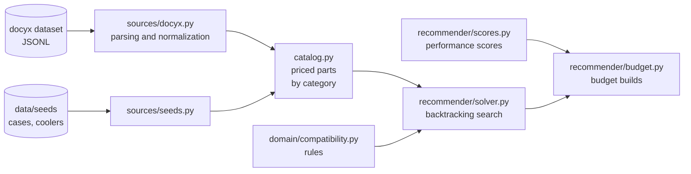

# pcbuilder

PC part picker: given a budget and a use case, it puts together a compatible configuration from real products with prices.

```
$ python scripts/budget_demo.py 1200

Profile: gaming. Requirements: RAM ≥ 32 GB, ≥ 2 modules; DDR5 ≥ 5600 MHz; NVMe SSD ≥ 1000 GB; PSU 80 Plus Bronze or better

=== Budget 1200 USD
  CPU            Intel Core i5-14400F                     125.99
  Graphics card  Asus PRIME (Radeon RX 9070 XT)           612.98
  Motherboard    ASRock H610M-HDV/M.2+ D5                  89.57
  Memory         TEAMGROUP T-Create Expert 32 GB           72.99
  Storage        PNY CS1030                                49.99
  Power supply   Apevia Prestige                           51.99
  Case           Montech AIR 903 MAX                       74.99
  CPU cooler     Thermalright Assassin X 120 Refined SE    17.89
  Total                                                  1096.39
```

## Features

- **Compatibility checks** — 14 rules: socket, memory type and module count, form factors, graphics card length and cooler height vs. the case, PSU wattage and connectors, storage slots. Works on incomplete builds too, so it suits both a step-by-step builder and automatic search.
- **Real data loading** — ~24,000 parts from an open PCPartPicker snapshot, normalized: socket inferred from microarchitecture, motherboard memory type from its name and socket, graphics card TDP from its chipset.
- **Build completion** — pick a CPU and a graphics card, and the solver fills in the rest as cheaply as possible while respecting compatibility and quality requirements.
- **Budget builds** — give an amount and a profile ("gaming" or "workstation") and get the highest-scoring build that fits the budget.

## How it works



1. **Sources** turn third-party data into domain models (`CPU`, `Motherboard`, `RamKit`, …) and prices (`Offer`). A record that can't be parsed reliably is rejected with a reason: better to skip a part than to load it with wrong data.
2. **The catalog** collects parts from all sources and keeps only those that have a price, sorted from cheapest to most expensive.
3. **The solver** fills categories one at a time, trying candidates from cheapest to most expensive. The partial build is checked after each part, and lookahead prunes any choice that would leave one of the remaining categories impossible to fill.
4. **Budget builds** go through "CPU + graphics card" pairs from best score to worst. Pairs that exceed the budget even at their lower price bound are discarded without a search. For gaming the score is the bottleneck: `min(graphics card, CPU × 1.2)`, so the solver doesn't overpay for a CPU the graphics card won't keep busy anyway.

## Quick start

Requires **Python 3.12+**.

```bash
git clone https://github.com/kchaumeow/pc-builder.git
cd pc-builder

python3.12 -m venv .venv
source .venv/bin/activate
pip install -e ".[dev]"

pytest
```

The scripts need the dataset. Clone it **next to** the project:

```bash
git clone --depth 1 https://github.com/docyx/pc-part-dataset.git ../pc-part-dataset
```

By default the scripts look for it in `~/projects/pc-part-dataset`. Set a different path with an environment variable:

```bash
export DOCYX_PATH=../pc-part-dataset
```

### Scripts

| Command | What it does |
|---|---|
| `python scripts/budget_demo.py` | builds for several budgets, "gaming" profile |
| `python scripts/budget_demo.py 1500` | a single budget |
| `python scripts/budget_demo.py 2000 --work` | "workstation" profile — favors multi-core performance |
| `python scripts/solve_demo.py` | completes a build around a given CPU and graphics card |
| `python scripts/demo_build.py` | hand-picked build from real parts, then checks it |
| `python scripts/explore_docyx.py [category …]` | dataset exploration: field values, loader stats, unexpected rejections |

### From code

```python
from decimal import Decimal
from pathlib import Path

from pcbuilder.catalog import load_catalog
from pcbuilder.domain.compatibility import check
from pcbuilder.recommender.budget import best_build
from pcbuilder.recommender.scores import GAMING
from pcbuilder.recommender.solver import Requirements

catalog = load_catalog(Path("../pc-part-dataset"))

result = best_build(catalog, Decimal(1200), GAMING, Requirements(min_ram_gb=32))
build = result.solution.build
print(build.cpu.name, build.gpu.chipset, result.solution.total)

check(build, complete=True)  # [] — no issues
```

## Structure

```
pc-builder/
├── src/pcbuilder/
│   ├── domain/
│   │   ├── models.py          # part, build and offer models
│   │   └── compatibility.py   # compatibility and completeness rules, check()
│   ├── sources/
│   │   ├── docyx.py           # docyx dataset loader: parsing, normalization, prices
│   │   └── seeds.py           # loader for reference data in data/seeds
│   ├── recommender/
│   │   ├── solver.py          # build completion, quality requirements
│   │   ├── scores.py          # performance scores, profiles
│   │   └── budget.py          # budget builds
│   └── catalog.py             # priced parts by category
├── data/seeds/                # hand-filled reference data
├── scripts/                   # exploration and demo scripts
└── tests/                     # tests for rules, loaders, reference data and the solver
```

`domain/` has no external dependencies: it holds hardware knowledge that is true regardless of where the data came from. The solver only works with the catalog and knows nothing about sources — a new source is plugged in through `catalog.py` without touching the search.

## Compatibility rules

| Rule | Checks | Level |
|---|---|---|
| socket | CPU ↔ motherboard | error |
| memory ↔ motherboard | type, module count, maximum capacity | error |
| memory ↔ CPU | supported memory types | error |
| PSU wattage | power draw × 1.25; graphics card vendor recommendation | error / warning |
| PSU connectors | 8-pin; 12VHPWR directly or via an adapter | error / warning |
| motherboard ↔ case | form factor | error |
| graphics card ↔ case | length | error |
| cooler ↔ case | tower height | error |
| PSU ↔ case | form factor, length | error |
| cooler ↔ CPU | socket; heat dissipation | error / warning |
| storage ↔ motherboard | M.2 slots and SATA ports | error |
| cooling present | bundled or separate cooler | error, complete builds only |
| video output present | graphics card or integrated graphics | error, complete builds only |

**Error** — it won't assemble or won't work. **Warning** — it will assemble, but with a risk or a trade-off. If a required value is missing from the data (`None` means "unknown", as opposed to `0` meaning "known to be absent"), the rule stays silent.

## Data and limitations

The project currently runs on a single source plus reference data. It's important to know where the results can be trusted and where they can't.

**Source — [docyx/pc-part-dataset](https://github.com/docyx/pc-part-dataset)** (MIT), a PCPartPicker snapshot. Prices are **US prices in dollars** as of the snapshot; discontinued products have no price and are excluded from builds.

**Coverage** — only platforms where the socket reliably determines compatibility:

| | Included | Not included |
|---|---|---|
| CPUs | AM5 (Zen 4/5), AM4 (Zen 2/3), LGA1700, LGA1851 | Zen/Zen+, Intel before 12th gen, Threadripper, EPYC, Xeon |
| Motherboards | AM5, AM4 500 series, LGA1700, LGA1851 | AM4 300/400 series, older sockets |
| Graphics cards | RTX 30/40/50, RX 6000/7000/9000, Intel Arc | older generations, professional cards |
| Memory | DDR2–DDR5 | DDR1 |

**Approximate data** worth checking against primary sources:

- `GPU_TDP_W` in `sources/docyx.py` — reference graphics card power ratings;
- `GPU_PERFORMANCE`, `ARCHITECTURE_IPC` in `recommender/scores.py` — performance scores;
- `data/seeds/*.json` — case limits and cooler specs (every entry has `"verified": false`).

**Missing from the data** — the corresponding checks are skipped:

- number of M.2 slots and SATA ports on motherboards;
- power connectors on graphics cards and most power supplies;
- case support for liquid cooling radiators.

**Heuristic:** LGA1700 motherboards with 700-series chipsets and no DDR4 marker in the name are assumed to be DDR5. 600-series boards without a marker are rejected — manufacturers don't follow the naming convention there.

## Development

```bash
pip install -e ".[dev]"
pre-commit install
```

`pre-commit install` sets up two hooks:

- **pre-commit** — `ruff check --fix`, `ruff format`, `pytest` (runs from the project's `.venv`, no need to activate the environment);
- **commit-msg** — message format: `<emoji> <type>(<scope>): <subject>`, the type is optional.

```
✨ feat(solver): add budget search
🐛 (api): return 404 for unknown build
```

Run everything manually: `pre-commit run --all-files`. CI (GitHub Actions) runs the same `ruff check`, `ruff format --check` and `pytest` on every push and pull request.

### Principles

- **Units in field names:** `length_mm`, `tdp_w`, `capacity_gb`, `speed_mhz`.
- **`None` means "unknown", `0` / `False` means "known to be absent".** For numbers, use `is not None`, not a truthiness check.
- **Boundary tests:** for every limit, a pair of "exactly at the limit" / "one over".
- **Third-party data: skip and count; our own data: fail loudly.** The dataset loader rejects malformed records with a reason; the reference data loader fails on the first error.
- **Explore first, then write the loader:** `scripts/explore_docyx.py` shows the real field values before any code is written for them.

### Adding a category from the dataset

1. Explore: add the category to `CATEGORIES` in `scripts/explore_docyx.py` without `parse` and look at the field values.
2. Loader: a `parse_*` function in `sources/docyx.py` and tests on real records in `tests/test_docyx.py`.
3. Wire it up: `parse` and the expected rejection reasons in `CATEGORIES`; make sure there are zero unexpected rejections.
4. Catalog: add the file to `DOCYX_FILES` in `catalog.py`.

## Status

- [x] Models and compatibility rules
- [x] Dataset loading: memory, CPUs, motherboards, PSUs, graphics cards, storage
- [x] Case and cooler reference data
- [x] Prices and catalog
- [x] Solver: build completion, quality requirements
- [x] Budget builds with performance scores
- [ ] API and web interface
- [ ] Verify reference data and scores against primary sources
- [ ] Prices from European stores (Geizhals), in euros
- [ ] Database storage, regular price updates
